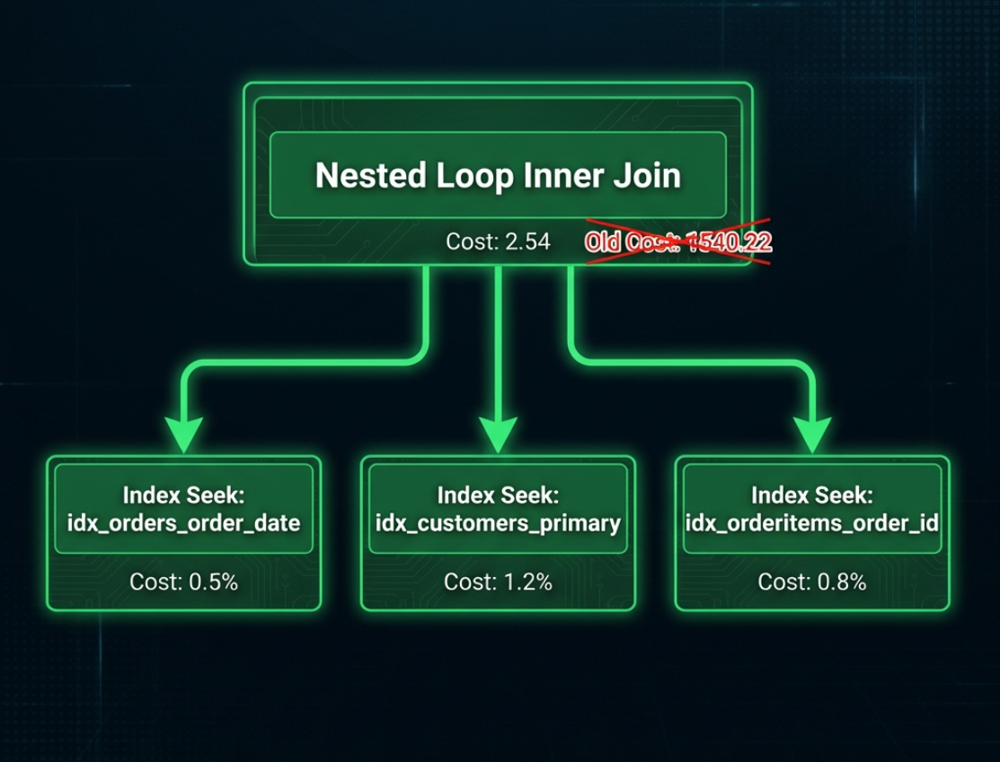
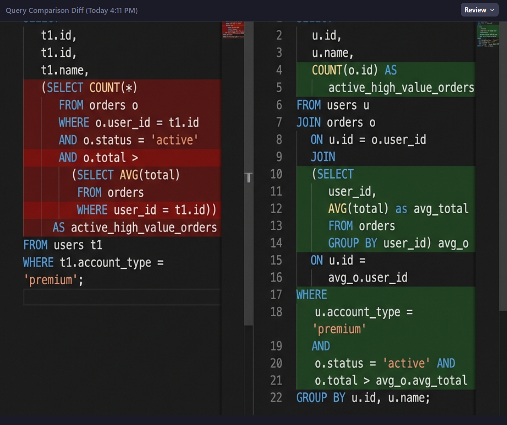

# Query Analysis Notes

## Overview

This document summarizes the performance issues identified in the original slow queries and the recommended optimizations.

---

## Query 1: Monthly Sales Aggregation

### Original Issues

| Issue | EXPLAIN Indicator | Impact |
|-------|-------------------|--------|
| Full table scan on `orders` | `type: ALL` | Very High |
| Function on indexed column | `YEAR()`, `MONTH()` | Prevents index use |
| SELECT * returns all columns | Extra data transfer | Medium |
| Missing join indexes | `key: NULL` | High |



### Root Cause
```sql
WHERE YEAR(o.order_date) = 2025 AND MONTH(o.order_date) = 6
```
Using functions on the `order_date` column prevents MySQL from using any index on that column.

### Recommended Fixes
1. Replace date functions with range comparison
2. Add composite index on join columns
3. Select only needed columns

---

## Query 2: Customer Purchase History

### Original Issues

| Issue | EXPLAIN Indicator | Impact |
|-------|-------------------|--------|
| Correlated subqueries | `DEPENDENT SUBQUERY` | Critical |
| 4 subqueries per row | Scans orders 4x per customer | Critical |
| No index on customer_status | Full scan for filter | High |

### Root Cause
```sql
(SELECT COUNT(*) FROM orders o WHERE o.customer_id = c.customer_id) AS total_orders,
(SELECT SUM(total_amount) FROM orders o WHERE o.customer_id = c.customer_id) AS total_spent,
...
```
Each correlated subquery scans the orders table once per customer row.

### Recommended Fixes
1. Convert to single JOIN with GROUP BY
2. Add index on `orders.customer_id`
3. Add index on `customers.customer_status`

---

## Query 3: Product Performance Analysis

### Original Issues

| Issue | EXPLAIN Indicator | Impact |
|-------|-------------------|--------|
| Missing index on product_id | Full scan on order_items | High |
| Window function on large result | Memory intensive | Medium |
| Complex GROUP BY | `Using temporary; Using filesort` | High |

### Root Cause
Missing indexes on foreign key columns cause expensive join operations.

### Recommended Fixes
1. Add index on `order_items.product_id`
2. Add index on `order_items.order_id`
3. Add composite index for the join pattern
4. Consider pre-aggregating in a summary table

---

## Query 4: Customer Search (LIKE with Leading Wildcard)

### Original Issues

| Issue | EXPLAIN Indicator | Impact |
|-------|-------------------|--------|
| Leading wildcard `%pattern%` | `type: ALL` | Critical |
| OR conditions | Can't use single index | High |
| No full-text index | Inefficient text search | High |

### Root Cause
```sql
WHERE c.first_name LIKE '%john%'
   OR c.last_name LIKE '%smith%'
```
Leading wildcards (`%pattern`) force full table scans as MySQL cannot use B-tree indexes.

### Recommended Fixes
1. Use FULLTEXT index for text search
2. Convert OR to UNION for index utilization
3. Consider removing leading wildcard if possible

---

## Query 5: Date Range Report

### Original Issues

| Issue | EXPLAIN Indicator | Impact |
|-------|-------------------|--------|
| DATE() function on column | Prevents index usage | Critical |
| No index on order_date | Full table scan | High |
| Heavy aggregation | CPU intensive | Medium |

### Root Cause
```sql
WHERE DATE(o.order_date) BETWEEN '2025-01-01' AND '2025-06-30'
```
Using `DATE()` function on `order_date` prevents index usage.

### Recommended Fixes
1. Rewrite date filter without function
2. Add index on `order_date`
3. Consider date partitioning for very large tables

---

## Summary of Optimization Opportunities

### Index Additions Required

| Table | Index Name | Columns | Purpose |
|-------|-----------|---------|---------|
| `orders` | `idx_order_date` | `order_date` | Date filtering |
| `orders` | `idx_customer_id` | `customer_id` | JOIN optimization |
| `orders` | `idx_status_date` | `order_status, order_date` | Filtered reports |
| `order_items` | `idx_order_product` | `order_id, product_id` | JOIN optimization |
| `order_items` | `idx_product_id` | `product_id` | Product analysis |
| `customers` | `idx_status` | `customer_status` | Status filtering |
| `customers` | `ft_search` | `first_name, last_name, email` | FULLTEXT search |
| `products` | `idx_category_active` | `category_id, is_active` | Product filtering |

### Query Rewrite Priorities



1. **High Priority**: Convert correlated subqueries to JOINs
2. **High Priority**: Remove functions from WHERE clauses
3. **Medium Priority**: Replace `SELECT *` with specific columns
4. **Medium Priority**: Use FULLTEXT search for text patterns

### Expected Improvements

| Query | Original Time* | Estimated After | Improvement |
|-------|---------------|-----------------|-------------|
| Query 1 | 15-30s | 0.5-2s | 90%+ |
| Query 2 | 60-120s | 2-5s | 95%+ |
| Query 3 | 20-45s | 3-8s | 80%+ |
| Query 4 | 10-20s | 0.1-1s | 95%+ |
| Query 5 | 25-50s | 1-3s | 95%+ |

*Estimated times based on 1M+ rows, actual times will vary based on hardware.

---

## Next Steps

1. Review proposed index definitions in `04_indexes/index_definitions.sql`
2. Apply indexes to database
3. Execute optimized queries from `03_optimized_queries/optimized_queries.sql`
4. Run benchmarks to measure actual improvements
