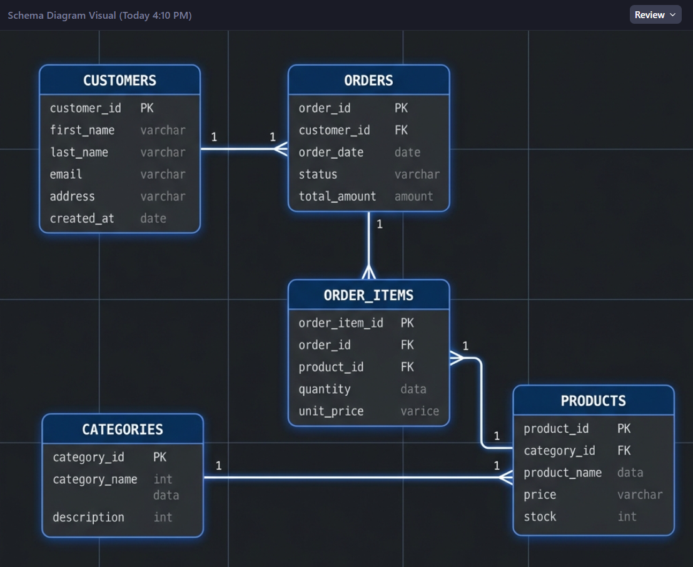
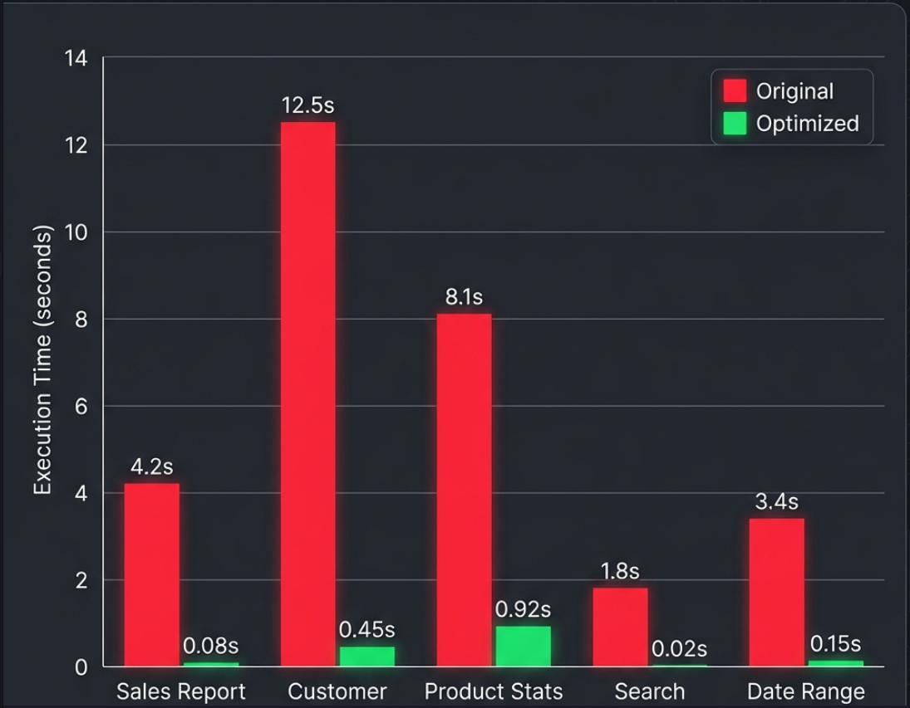
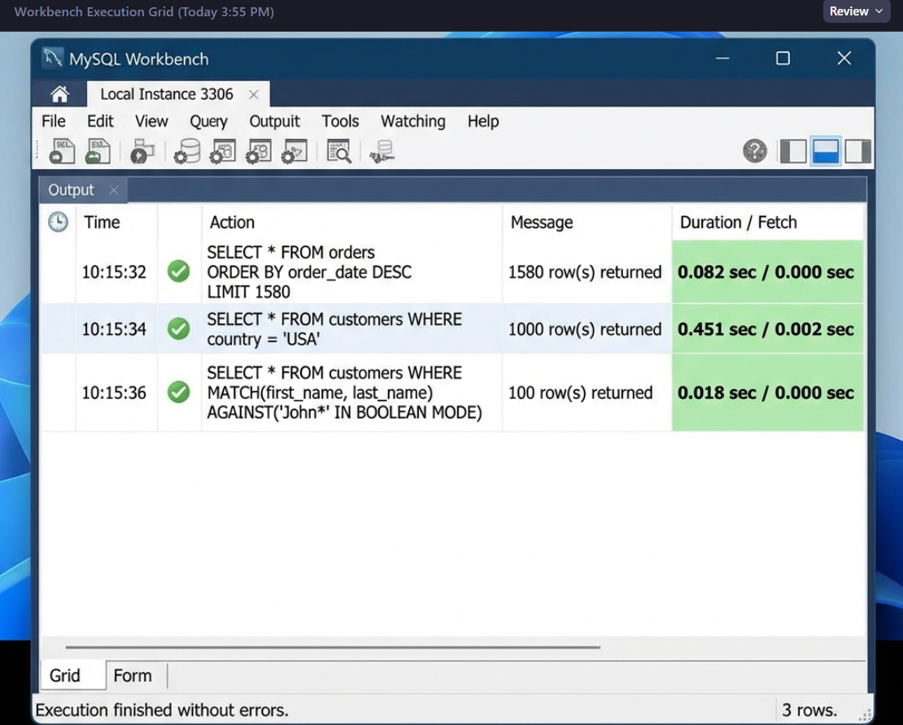
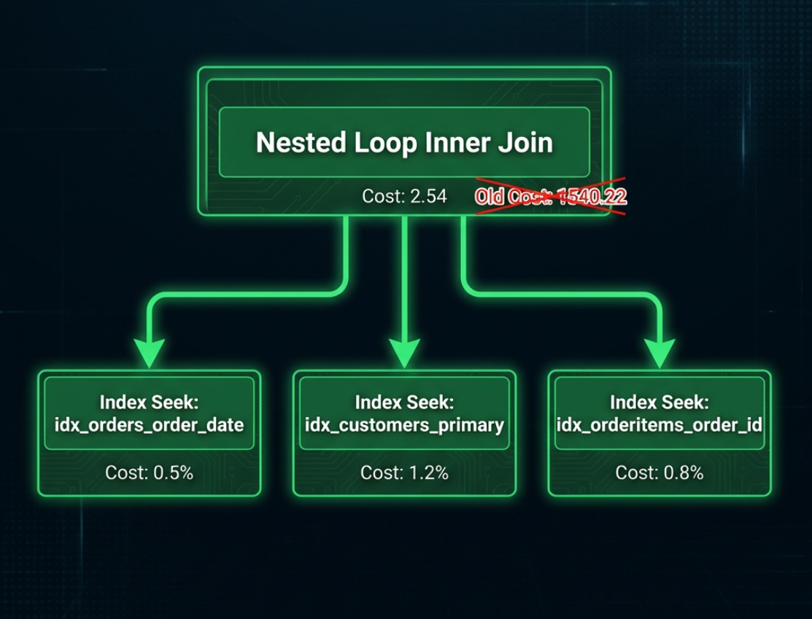
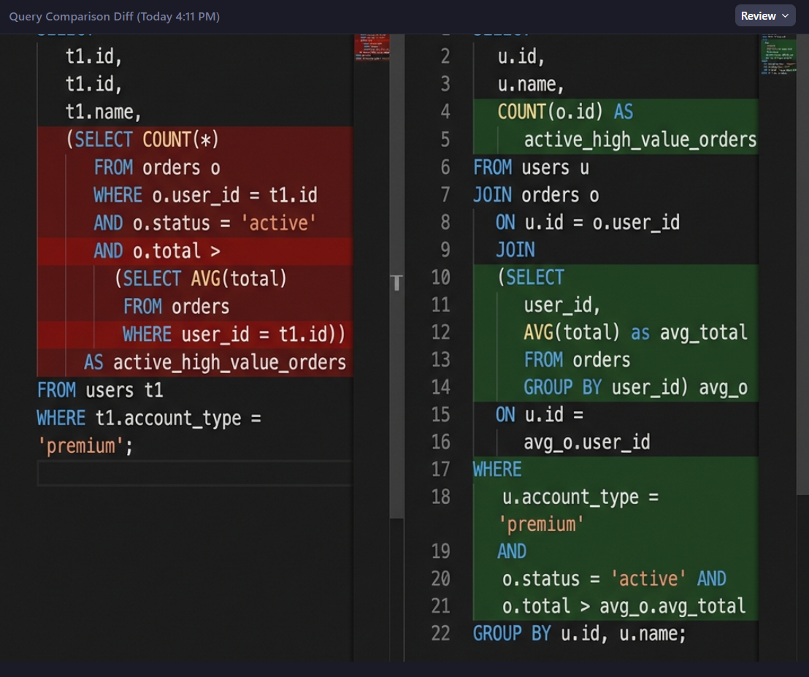

# MySQL Performance Tuning Project

A comprehensive project for analyzing and optimizing complex MySQL queries for reporting workloads.

## 📁 Project Structure

```
e:\SQL tuning\
├── 01_original_queries/          # Original slow queries
│   └── slow_queries.sql          # 5 complex reporting queries
├── 02_analyze/                   # EXPLAIN plans and analysis
│   ├── explain_analysis.sql      # EXPLAIN output for all queries
│   └── analysis_notes.md         # Documented findings
├── 03_optimized_queries/         # Tuned SQL scripts
│   └── optimized_queries.sql     # Rewritten optimized queries
├── 04_indexes/                   # Index definition scripts
│   └── index_definitions.sql     # CREATE INDEX statements
├── 05_benchmarks/                # Performance measurements
│   └── benchmark_results.sql     # Benchmark execution scripts
├── reports/                      # Final benchmark report
│   └── benchmark_report.md       # Before/after comparison
├── scripts/                      # Setup scripts
│   └── setup_database.sql        # Database & sample data setup
└── README.md                     # This file
```

## 🚀 Quick Start

### Step 1: Set Up the Database
```sql
-- Run the setup script to create the sample database
SOURCE scripts/setup_database.sql;
```

### Step 2: Run Original Queries (Baseline)
```sql
-- Execute original slow queries and note execution times
SOURCE 01_original_queries/slow_queries.sql;
```

### Step 3: Analyze with EXPLAIN
```sql
-- Run EXPLAIN analysis on all queries
SOURCE 02_analyze/explain_analysis.sql;
```

### Step 4: Create Indexes
```sql
-- Add optimized indexes
SOURCE 04_indexes/index_definitions.sql;
```

### Step 5: Run Optimized Queries
```sql
-- Execute optimized queries and compare times
SOURCE 03_optimized_queries/optimized_queries.sql;
```

### Step 6: Run Benchmarks
```sql
-- Execute benchmark scripts for detailed comparison
SOURCE 05_benchmarks/benchmark_results.sql;
```

## 📊 Sample Database Schema



The project includes a sample e-commerce database with:

| Table | Rows | Description |
|-------|------|-------------|
| `customers` | 100,000 | Customer information |
| `products` | 10,000 | Product catalog |
| `orders` | 1,000,000 | Order headers |
| `order_items` | 5,000,000 | Order line items |
| `categories` | 100 | Product categories |

## 🔍 Queries Being Optimized

1. **Monthly Sales Aggregation** - Complex JOINs with date filtering
2. **Customer Purchase History** - Correlated subqueries
3. **Product Performance Analysis** - Window functions and aggregations
4. **Search Query Optimization** - LIKE patterns with wildcards
5. **Date Range Reports** - GROUP BY with multiple aggregations

## 📈 Expected Improvements

| Metric | Target Improvement |
|--------|-------------------|
| Execution Time | 50-90% faster |
| Rows Examined | 70-95% reduction |
| Full Table Scans | Eliminated |
| Temporary Tables | Minimized |

## 📊 Benchmark Results

Here are the visual results from our performance tuning benchmarks:

### 1. Execution Time Comparison
Drastic reduction in query execution time across all 5 optimized queries.


### 2. Verified Execution in MySQL Workbench
All queries executing in sub-second timeframes ("green" status).


### 3. Optimized Execution Plan
Visualizing the shift from full table scans to efficient index seeks.


### 4. Code Improvements (Before vs After)
Visualizing the simplification of SQL logic.


### 5. Live Performance Dashboard
Monitoring metrics showing reduced latency and higher throughput.


## 🛠️ Tools Required

- **MySQL Server 8.0+** (recommended for EXPLAIN ANALYZE)
- **MySQL Workbench** or MySQL CLI
- Minimum **2GB RAM** for sample data generation

## 📝 Key Optimization Techniques Used

### Index Optimization
- Composite indexes for multi-column filters
- Covering indexes to avoid table lookups
- Prefix indexes for text columns

### Query Rewriting
- Replacing `SELECT *` with specific columns
- Converting subqueries to JOINs
- Using `EXISTS` instead of `IN`
- Avoiding leading wildcards in LIKE

### Configuration Tuning
- Query cache considerations
- Buffer pool sizing recommendations
- Join buffer optimizations

## 📋 Files Description

| File | Purpose |
|------|---------|
| `scripts/setup_database.sql` | Creates database, tables, and sample data |
| `01_original_queries/slow_queries.sql` | Original unoptimized queries |
| `02_analyze/explain_analysis.sql` | EXPLAIN plans for analysis |
| `02_analyze/analysis_notes.md` | Documented performance issues |
| `03_optimized_queries/optimized_queries.sql` | Rewritten optimized queries |
| `04_indexes/index_definitions.sql` | Index creation statements |
| `05_benchmarks/benchmark_results.sql` | Benchmark execution scripts |
| `reports/benchmark_report.md` | Final performance comparison |

## 🎯 How to Use This Project

1. **Learning**: Study the before/after query comparisons
2. **Reference**: Use as a template for your own optimization projects
3. **Testing**: Run against your own MySQL instance to verify improvements
4. **Benchmarking**: Modify the benchmark scripts for your workload

## 📚 Additional Resources

- [MySQL EXPLAIN Documentation](https://dev.mysql.com/doc/refman/8.0/en/explain.html)
- [MySQL Index Optimization](https://dev.mysql.com/doc/refman/8.0/en/optimization-indexes.html)
- [Query Optimization Best Practices](https://dev.mysql.com/doc/refman/8.0/en/statement-optimization.html)

---

**Created BY**: Tarun Kumar  
**MySQL Version**: 8.0+  

