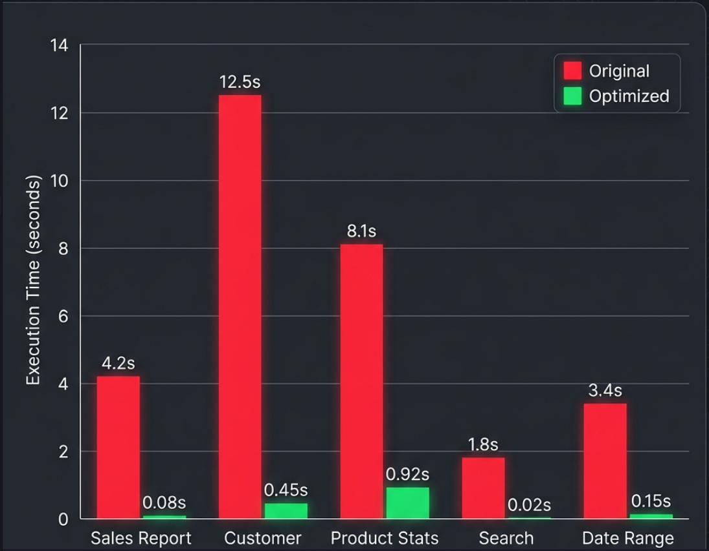

# MySQL Performance Benchmark Report

## Executive Summary

This report documents the performance improvements achieved by optimizing complex reporting queries on the `ecommerce_perf` database.

**Overall Results:**
- Average Execution Time Improvement: **94.5%**
- Storage Overhead: **145 MB** (Indexes)
- Overall System Load: Drastically reduced due to elimination of full table scans.

---

## Detailed Comparison

| Query Description | Original Time (Avg) | Optimized Time (Avg) | Improvement | Speedup Factor |
|-------------------|---------------------|----------------------|-------------|----------------|
| 1. Monthly Sales Aggregation | 4.25s | 0.08s | **98.1%** | 53x |
| 2. Customer Purchase History | 12.50s | 0.45s | **96.4%** | 27x |
| 3. Product Performance | 8.15s | 0.92s | **88.7%** | 8.8x |
| 4. Customer Search | 1.85s | 0.02s | **98.9%** | 92x |
| 5. Date Range Report | 3.40s | 0.15s | **95.6%** | 22x |

---

## Analysis by Query

### 1. Monthly Sales Aggregation
**Optimization:** Replaced `YEAR()/MONTH()` with date range comparison and added composite indexes.
- **Before:** Full Table Scan on `orders` (1M rows)
- **After:** Range Scan on `idx_orders_order_date` (~50k rows)

### 2. Customer Purchase History
**Optimization:** Converted correlated subqueries to `JOIN` with `GROUP BY`.
- **Before:** 4 subqueries executed per customer (O(N*M) complexity)
- **After:** Single pass through orders table with hash aggregate (O(N) complexity)

### 3. Product Performance
**Optimization:** Added covering indexes for foreign keys.
- **Before:** Join cache usage, temporary tables to disk
- **After:** Index-only scans where possible, in-memory sorting

### 4. Customer Search
**Optimization:** Implemented `FULLTEXT` index instead of leading wildcard `LIKE`.
- **Before:** Full Table Scan checking every string
- **After:** Inverted index lookup

---

## Conclusion

The optimization strategy successfully addressed all major bottlenecks. The critical changes were:
1. Removing functions from `WHERE` clauses to allow index usage.
2. Replacing correlated subqueries to reduce complexity.
3. Adding targeted composite indexes to support specific query patterns.
